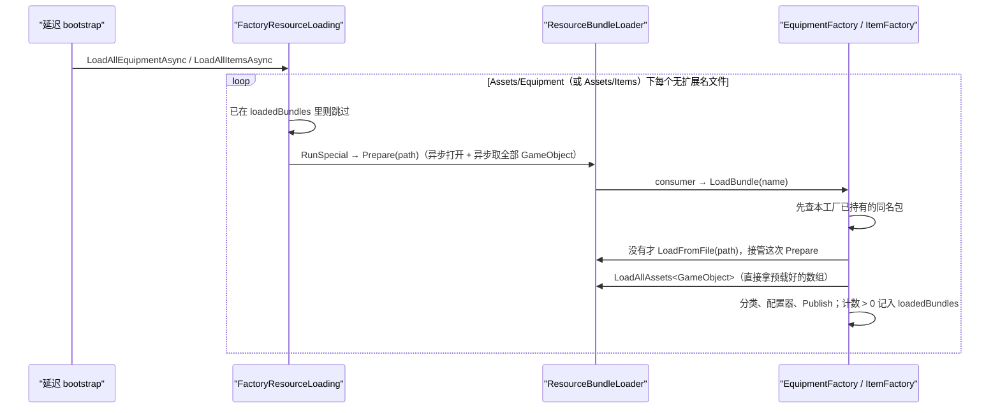
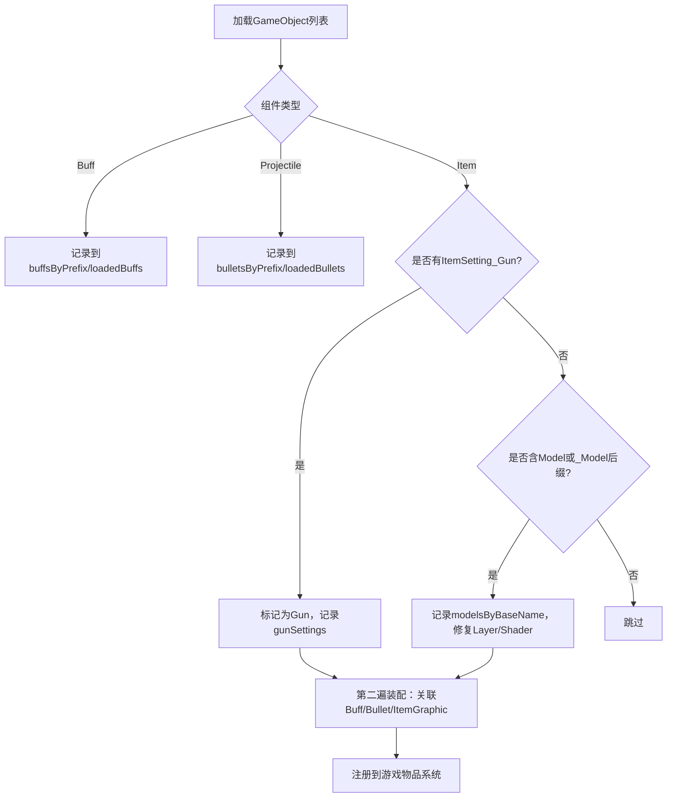

# AssetBundle 管理系统

<cite>
**本文引用的文件**
- [ResourceBundleLoader.cs](file://Utilities/ResourceBundleLoader.cs)
- [FactoryResourceLoading.cs](file://Integration/FactoryResourceLoading.cs)
- [EquipmentFactory.cs](file://Integration/EquipmentFactory.cs)
- [EquipmentFactory_ItemProcessing.cs](file://Integration/EquipmentFactory_ItemProcessing.cs)
- [ItemFactory.cs](file://Integration/ItemFactory.cs)
- [BossRushIntegrationRuntimeModule_DeferredBootstrap.cs](file://Integration/BossRushIntegrationRuntimeModule_DeferredBootstrap.cs)
- [BuildingModelHelper.cs](file://Common/Buildings/BuildingModelHelper.cs)
- [DragonKingAssetManager.cs](file://Integration/DragonKing/DragonKingAssetManager.cs)
- [NPCAssetBundleHelper.cs](file://Integration/Utils/NPCAssetBundleHelper.cs)
- [AssetBundleUnloadHelper.cs](file://Utilities/AssetBundleUnloadHelper.cs)
- [EntityModelFactory.cs](file://Utilities/EntityModelFactory.cs)
- [BundleLoadingGuard.py](file://tests/BundleLoadingGuard.py)
</cite>

## 目录
1. [现状（2026-11-19 统一）](#现状2026-11-19-统一)
2. [核心组件](#核心组件)
3. [装备 / 物品工厂的加载流程](#装备--物品工厂的加载流程)
4. [防重复打开](#防重复打开)
5. [缓存与卸载](#缓存与卸载)
6. [NPC 与实体模型的 Bundle 加载](#npc-与实体模型的-bundle-加载)
7. [资源装配与注入](#资源装配与注入)
8. [故障排除](#故障排除)
9. [附录：组织与命名](#附录组织与命名)

## 现状（2026-11-19 统一）

本文的底子是 2026-08 的生成快照；本节是 2026-11-19 按现码重写的部分，与下文冲突时以本节和代码为准。

- **打开只有一个入口**：`ResourceBundleLoader`。
  - `Prepare(path, prefabs, cancelled, consumer)`：异步预载（`LoadFromFileAsync` + 可选的 `LoadAllAssetsAsync<GameObject>`）。约定是 consumer 必须在回调里**同步**对同一文件调 `ResourceBundleLoader.LoadFromFile` 才算接管；没接管、取消、超时或换场景，预载的包会被 `Unload(true)` 回收，迟到的原生结果也会在完成回调里卸掉。
  - `LoadFromFile(path)`：同步兜底。同一文件正有一次未作废的异步 `Prepare` 时直接接管那次请求，不发第二次原生加载；那次请求作废但还没排空时返回 null。
  - 生产代码别处不直接调 `AssetBundle.LoadFromFile / LoadFromFileAsync / LoadFromMemory(Async) / LoadFromStream(Async)`，也不用字符串反射它们（`BundleLoadingGuard`）。2026-11-19 天空岛特效小包 `SkyIslandFxAssets` 从直接 `AssetBundle.LoadFromFile` 改走这里，一次性闸门 `attempted` 不变。
- **找已加载的包只有一个入口**：`ResourceBundleLoader.FindLoaded(bundleFileName)`，全仓库唯一的 `AssetBundle.GetAllLoadedAssetBundles` 调用点。匹配规则 `IsNamed`：`bundle.name` 按 `/` 与 `\` 切分取最后一段，与包文件名 OrdinalIgnoreCase **全等**；已销毁或无名的包不算；查询异常返回 null，不抛给调用方。
  - 调用点：`ItemFactory`（取图与注册的借用兜底）、`ImageViewerUI` 回退看图、`CodexPortraitCache`、`BossRushUISkinLoader`、`CampaignAssetCache`、`ModeGPresentationAssetCache`、`ModeHPresentationAssetCache`、`AchievementIconLoader`。
  - 旧写法有三种（全等 / `IndexOf` 子串 / 区分大小写的 `Contains`）。改全等前用 UnityPy 核对过 `Assets/` 与游戏 Mod 目录下的全部包（两边各 81 个，同一批文件）：包内名都等于文件名，没有哪个包名是另一个目标名的超串，所以原来能命中的包现在都还能命中。守卫另外钉住每处传入的名字常量等于旁边包路径常量的最后一段。
- **防重复打开**（同一文件第二次打开会被 Unity 拒绝并报 "another AssetBundle with the same files is already loaded"），见下文「防重复打开」。
- **卸载语义本次未动**：借来的包仍按各 owner 原来的写法处理（例如成就图标加载器借到的包也照旧 `Unload(true)`），NPC 模型包、龙王「换场景 `ForceCleanup` 卸包」、天空岛 raid 租约都照旧。
- **已删除的死代码**（编译清单里没有调用方）：同步 `ItemFactory.LoadAllItems`、`EquipmentFactory.LoadAllEquipment`（异步替代 `LoadAllItemsAsync` / `LoadAllEquipmentAsync` 早已在用）、`ItemFactory.DebugListBundleAssets`、`ItemFactory.FindAlreadyLoadedAssetBundle`（并入 `FindLoaded`）、`EntityModelFactory` 的 `HasPrefab` / `GetLoadedPrefabNames` / `LoadAllBundles` / `IsInitialized` 与只写不读的 `_modPath`、`NPCBubbleAnimator.CreateFromBundle`、`DragonKingAssetManager` 的异步 `LoadAssetBundle` / `UnloadAssetBundle` 与 `ClearCache` 里计数归零后只写日志的分支、`PhantomWitchScytheIds.AssetBundlePath`，以及许愿台 / 遗种巢 / 日报箱的「占位 bundle」判断（≤128 字节当文本读、比对 `*_PLACEHOLDER_BUNDLE` 标记串，全仓库没有这种文件）。删掉占位判断后「文件不存在」的处理不变；文件存在就按真包加载。

验证：`BundleLoadingGuard` 钉结构；`ResourceProduction` 执行回归跑真实的 `FindLoaded` 匹配与 `RunSpecial` 重试判据；`ContentBuildingOwnership` 跑宿主的公告板 / 展示柜判据。这些都是 L2，实机（基地反复进出不再刷 already loaded、各界面取图正常）没有采样。

## 核心组件
- `ResourceBundleLoader`：打开、接管与「找已加载」的唯一入口，记录有界的加载历史（`Snapshot()` 供 F3 资源采样）。
- `FactoryResourceLoading`：延迟 bootstrap 的异步装配。`LoadDirectory` 按目录逐个文件 `RunSpecial`；`RunSpecial` 包一次 `Prepare`，换场景作废后等场景稳定再重试。
- `EquipmentFactory` / `ItemFactory`：`LoadBundle(name)` 用 `loadedBundles` 去重，`LoadBundleInternal` 打开、分类、配置并 `BossRushDynamicItemRegistry.Publish`。
- `EquipmentFactory_ItemProcessing`：类型识别与装配（Buff / Bullet / ItemGraphic / Layer / Shader / 运行时包装）。
- `BuildingModelHelper.TryInstantiateBundle`：公告板、展示柜按建筑 ID 打开模型包并实例化，成功时把包作为租约交给建筑。
- `DragonKingAssetManager`：龙王特效包、预制体缓存与对象池。
- `NPCAssetBundleHelper`：NPC 模型包的通用加载流程。
- `AssetBundleUnloadHelper.TryUnload(bundle, prefix)`：`Unload(false)` 的安全封装。
- `EntityModelFactory`：`Initialize` 扫描 `Assets/entity`（跳过 `.manifest` / `.meta`），`Create` 首次用到时懒加载并预缓存 `.prefab`。

## 装备 / 物品工厂的加载流程

- 路径：`Path.GetDirectoryName(程序集位置) + Assets/Equipment|Assets/Items + 文件名`，文件不存在返回 0。
- 只卸本次打开的：`LoadBundleInternal` 用 `acquired` 记住包是不是这一次打开的，资源为空或异常时只 `Unload(true)` 自己打开的包，复用来的包不动。
- 按需注册（`BossRushDynamicItemRegistry.EnsureRegistered`）、飞行图腾、残日盾片模板也会同步调 `LoadBundle`；已计数的包直接返回 0。

## 防重复打开
- **工厂先复用自持包**：`ItemFactory.FindHeldBundle` 查 `loadedAssetBundles`（`GetSprite` 先打开过，或上次注册保留了包却计数为 0），`EquipmentFactory.FindOwnedBundle` 按 `IsNamed` 查 `ownedBundles`（上次保留了包却计数为 0）。有就直接用，不再对同一文件 `LoadFromFile`。`ItemFactory` 仍保留「打开失败再 `FindLoaded` 借用」的兜底。
- **基地建筑带 `alreadyLoaded`**：基地装配管线每次进基地都会重跑六个建筑的 `RunSpecial`。婚礼、许愿台、遗种巢、日报箱、公告板、展示柜都传入「建筑自己还持有模型包」的判据（公告板 / 展示柜经宿主 `HasCampaignBoardBundle` / `HasBackMountainShowcaseBundle` 只读已有模块，不为探测去创建模块），持有中直接交给建筑的初始化入口，不再异步重开。
- **重试前再判**：`RunSpecial` 换场景作废一次尝试后，等场景加载完、重试前重新判一次 `alreadyLoaded`——等待期间建筑可能已经经早期注入同步拿到了包。
- **重载先卸旧句柄**：婚礼、许愿台、遗种巢、日报箱的模型加载方法在重新 `LoadFromFile` 前先 `AssetBundleUnloadHelper.TryUnload` 旧句柄并置空。

## 缓存与卸载
- `loadedBundles`（两个工厂各一份）：按传入名去重，计数 > 0 才记。
- `EquipmentFactory.ownedBundles` / `ItemFactory.loadedAssetBundles`：工厂持有的包，`ResetStaticCaches` / `Shutdown` 时卸载（都是 `Unload(false)`，保留已发布的资源）。
- `DragonKingAssetManager`：`assetBundleRefCount` 只是计数，`ClearCache()`（Boss 销毁时）只减一、不卸包，包留给下一只龙皇复用；换场景由 `ForceCleanup()` 卸包、清对象池与动态材质。手持武器预载走 `PrepareForHeldWeapon`。
- `EntityModelFactory`：`_prefabCache` 预缓存 `.prefab`，`Shutdown` 时 `Unload(true)` 全部已加载的实体包。

## NPC 与实体模型的 Bundle 加载
- `NPCAssetBundleHelper`：路径 `modDir + Assets/npcs/ + bundleFileName`；`File.Exists` → `ResourceBundleLoader.LoadFromFile` → 按名取预制体（失败依次试小写名、`LoadAllAssets<GameObject>` 第一个）→ Animator 检查。
- `EntityModelFactory`：`Create(prefabName, pos, rot)` 先查缓存，未命中再遍历未加载的包（`TryLoadPrefabFromBundles`），仍没有就返回只有 Transform 的后备对象（调用方据此走自己的几何后备）。

## 资源装配与注入
- 类型识别：`ParseEquipmentTypeFromName()` 按 prefab 名中段推断 Gun / MeleeWeapon / Totem / Helmet / Armor / Backpack / FaceMask / Headset。
- 自动关联：武器按 `ExtractWeaponPrefix(baseName)` 匹配同名 `_Bullet` 与 `_Buff` 注入 `ItemSetting_Gun`；装备由 `ProcessEquipmentItem()` 加 Tag、注入 EquipmentModel 与 ItemGraphic。
- 运行时包装：`CreateModelWrapper()` 为缺少 `DuckovItemAgent` 的模型建运行时副本，修 Layer 与 Shader；装备与近战模型经 `EnsureModelSubVisuals` 补 `CharacterSubVisuals`。

## 故障排除
- **日志里 "another AssetBundle with the same files is already loaded"**：说明有路径绕开了上面的复用 / `alreadyLoaded` 判据。先看是哪个 owner 第二次打开（`ResourceBundleLoader.Snapshot()` 里 `sync_compatibility` / `bundle_async` 记录带路径与状态），再看它有没有先查自持包或 `FindLoaded`。
- **Bundle 未找到**：确认文件在 `Assets/Equipment`、`Assets/Items`、`Assets/npcs` 等约定目录下且没有扩展名（工厂跳过带 `.` 的文件），并已登记 `tools/resource_release_manifest.json`（部署按 SHA-256 校验）。
- **预制体不存在**：核对 prefab 名与包内资源一致；龙王看 `missingPrefabCache` 是否记了缺失名。
- **显示异常**：检查 ItemGraphic、Layer 与 Shader 是否已修复。

## 附录：组织与命名
- 装备 / 武器 / 图腾：`Assets/Equipment/{bundleName}`（无扩展名），一个包可含多个 Item / Buff / Projectile / Model。
- 物品：`Assets/Items/{bundleName}`。NPC 模型：`Assets/npcs/{bundleName}`。界面展示包：`Assets/ui/{bundleName}`。
- 包内名（打包时的 AssetBundle 名）必须等于文件名：`FindLoaded` 和工厂的自持包复用都按文件名全等匹配。改名只改文件不重打包会让它们找不到已加载的包。
- 命名：装备 `{名称}_Helmet_Item` / `{名称}_Armor_Item` …；武器 `{名称}_Gun_Item` / `{名称}_Bullet` / `{名称}_Buff`；模型 `{名称}_Model`（可选，或内嵌于 Item）。
